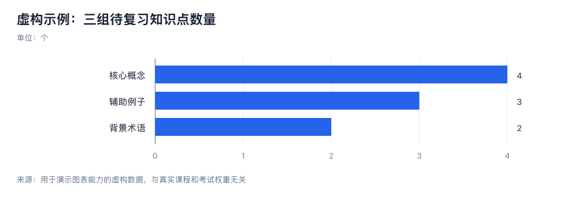

# 学习与会议知识整理助手

`knowledge-organizer` 把课堂笔记、课程材料和会议记录整理成简洁易懂、内容一致的 HTML 学习页与 Word 文档（.docx）。默认包含核心对照表与折叠自测，重要纠错和来源按需展开。

## 能做什么

| 能力 | 交付内容 |
| --- | --- |
| 总结与划重点 | 一句话主旨、重点速览、核心表格，减少重复 |
| 纠错 | 正文使用修正结果；原片段和依据在折叠附录，关键冲突在主表可见 |
| 重要性分级 | 重点 / 次要 / 了解即可融入主表，不另做重复分级表 |
| 表格与图表 | 对照表、概念图、流程图；有真实数值时生成 SVG 柱状图 |
| 记忆辅助 | 通常 3–5 题，答案默认折叠，先回忆再核对 |
| 必要知识发散 | 补足前置知识、易混概念、相关应用，默认最多 3 条 |
| 会议跟进 | 区分决策、建议、未决问题，整理负责人、截止日与验收条件 |

学习模式关注理解与应用；会议模式关注决策与跟进；混合材料分别整理。缺失信息不会被补成事实，会议中的建议不会被写成已通过的决议。

## 项目级安装

下载本仓库或克隆到本地。在目标项目中，将以下六项放入 `.agents/skills/knowledge-organizer/`：

```text
.agents/skills/knowledge-organizer/
├── SKILL.md
├── agents/openai.yaml
├── references/
├── scripts/
├── assets/
└── requirements.txt
```

例如，本仓库在项目外时，从目标项目目录执行（将路径换成实际位置）：

```bash
mkdir -p .agents/skills/knowledge-organizer
cp -R /path/to/knowledge-organizer/SKILL.md /path/to/knowledge-organizer/agents /path/to/knowledge-organizer/references /path/to/knowledge-organizer/scripts /path/to/knowledge-organizer/assets /path/to/knowledge-organizer/requirements.txt .agents/skills/knowledge-organizer/
```

重新打开项目或开始新对话，在 Skill 列表中检查是否加载。HTML / SVG 脚本使用 Python 3 标准库，双格式脚本另需 python-docx：`python3 -m pip install -r requirements.txt`。

## 触发方式

显式调用最清楚：

```text
$knowledge-organizer 整理以下课堂笔记，突出重点、减少重复，同时生成 HTML 与 Word（.docx），包含核心对照表和自测：
【粘贴笔记】
```

```text
$knowledge-organizer 整理以下会议记录，提取已确认决策、待办和未决问题，缺失负责人或日期请标为待确认：
【粘贴会议记录】
```

也支持自然语言，如“帮我整理学习笔记并划重点”“把会议记录变成行动清单”“生成复习表格、记忆卡和必要知识拓展”。自动匹配由运行环境决定；只说“帮我整理”而没有材料时，会先请你提供材料。

可附加要求：考试主题、学习阶段、会议日期、输出长度、保留原话、只做表格、生成可导出的图表。不会自动录音、参会、发送消息或设置提醒。

## 作业展示

- [学习示例](examples/study.md)：纠正带条件的概念错误，生成分级表、概念图和自测卡。
- [会议示例](examples/meeting.md)：区分决策与建议，保留冲突数据和缺失日期。
- [验收场景](tests/scenarios.md)：人工检查 Skill 是否保留证据、正确处理不确定性。
- [示例数值](examples/chart-data.json)与[SVG 图](examples/chart.svg)：数据均为虚构演示，不是用户真实笔记。



## 图表脚本与验证

```bash
python3 scripts/render_bar_chart.py examples/chart-data.json examples/chart.svg
python3 -m unittest discover -s tests -v
```

输入 JSON 必须包含 `title`、`unit`、`source` 和 `items`，每项提供唯一的 `label` 与有限数值 `value`。不接受未知值、重复标签、NaN 或无限值。支持正数、负数和全零数据；不能将概念的重要性凭空变成数值。

Skill 指令是模型行为约定，不是独立运行的应用。结构验证和脚本测试不能保证每次模型输出完全正确；遇到专业事实或冲突信息仍需依据来源核实。公开仓库仅收录 Skill 与虚构示例，不含真实课堂或会议记录。

## HTML 与 Word 双格式输出

默认在当前任务的 `outputs/knowledge-organizer/` 同时生成同名 `.html` 和 `.docx`，分别返回两个链接。两份使用同一份内容 JSON，知识、表格、来源和答案保持一致。主页面突出重点和核心表格，问答、纠错与来源按需展开；正文离线可读，适配窄屏，Word 中自测题与答案分开、附录完整展开，可编辑和打印。用户指定其他格式时优先遵循。不自动部署网站。

```bash
python3 scripts/render_notes_pair.py examples/notes-data.json /tmp/knowledge-notes
```

[HTML 示例](examples/notes.html)、[Word 示例](examples/notes.docx)与[示例数据](examples/notes-data.json)为虚构学习材料。使用说明见 [双格式交付](references/dual-output.md)，内容 JSON 格式见 [HTML 输出说明](references/html-output.md)。渲染脚本负责转义和排版，不替代知识判断与事实核实。
