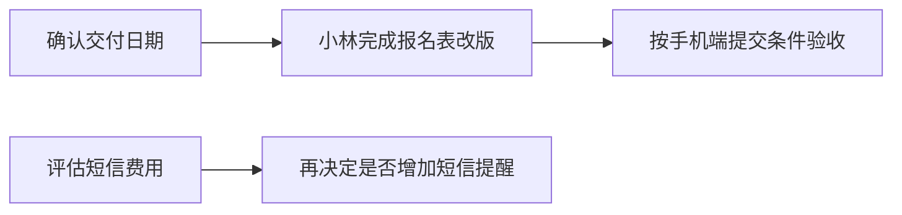

# 会议示例（虚构）

## 输入

> S1：负责人确认，本周先完成报名表改版，由小林负责；验收条件是手机端提交成功并展示成功提示。
> S2：小林说“我下周三交”，记录没有会议日期。
> S3：小陈建议增加短信提醒，负责人说需要评估费用再决定。
> S4：小林说本月报名人数 120，小陈说 135；没人说明统计截止时间与去重口径。
> S5：背景：上一版按钮是蓝色的。

## 示例输出

一句话：**已确认改版报名表；交付时间存在冲突，短信提醒尚未批准，报名数据待核实。** 覆盖 S1–S5。

### 重点与分级

| 内容 | 级别 | 依据 | 行动标准 |
| --- | --- | --- | --- |
| 报名表改版 | 重点 | S1 为确认决策 | 完成改版并通过手机端提交验收 |
| “本周”与“下周三”交期冲突 | 重点，待确认 | S1、S2 不一致 | 明确一致的交付日期；未提供会议日期，暂不转换 |
| 报名人数 120 / 135 | 重点，待确认 | S4 数据可能影响评估 | 核对截止时间、去重规则和统计范围 |
| 短信提醒 | 次要，未决 | S3 需要费用评估 | 先评估，不视为已批准开发 |
| 原按钮颜色 | 了解即可 | S5 背景说明 | 保留背景，不推断改版颜色 |

### 已确认决策

报名表改版由小林负责，验收要求为手机端提交成功并展示成功提示（S1）。截止日未达成一致。

### 行动清单

| 任务 | 负责人 | 截止日 | 验收或完成标准 | 来源 |
| --- | --- | --- | --- | --- |
| 报名表改版 | 小林 | 待确认：本周 / 下周三 | 手机端提交成功并展示成功提示 | S1、S2 |

【建议】另需确认交期、核对报名统计口径、评估短信成本；记录未指定这些事项的负责人或截止日，不能替参会者承诺。

### 纠错与待确认

未发现可直接修正的明确事实错误。S4 的两个报名数字保留并列，不能取平均值 127.5 冒充报名人数。S1、S2 的交期冲突需确认；不得根据整理当天日期推算“下周三”。

### 跟进流程图

【建议】以下为整理者提出的跟进流程，不是会议新决议。Mermaid 源码：

### 快速回忆

问题：已确认做什么？谁负责？如何验收？哪些结论不能直接确定？

答案：改版报名表，小林负责，手机端提交成功并出现成功提示；交期、报名人数和短信提醒均需进一步确认。

### 必要拓展

【补充解释】统计口径：比较两个数字前，需要确认统计时点、是否按人去重以及是否排除无效报名。它是核实 120 与 135 差异所需的知识，不能据此自动判定哪一个数字正确。
