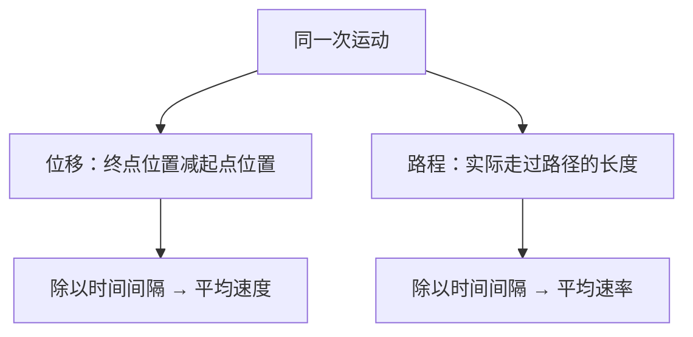

# 学习示例（虚构）

## 输入

> S1：老师说本节重点是平均速度与平均速率的区别。平均速度等于路程除以时间。
> S2：从 A 点向东走 100 米，再向西走 100 米回到 A 点，全程 40 秒。
> S3：平均速率等于路程除以时间。瞬时速度后续再讲。
> S4：老师举了导航软件显示速度的例子，还提到了测量仪器发展史。

请求：整理并纠错，生成概念图和记忆卡。

## 示例输出

一句话：**平均速度看位移，平均速率看路程**；覆盖 S1–S4。

### 30 秒重点速览

- **平均速度 = 位移 / 时间间隔**，有方向。
- **平均速率 = 路程 / 时间间隔**，是标量。
- 往返案例中，位移为 0 米，路程为 200 米：平均速度为 **0 米/秒**，平均速率为 **5 米/秒**。

### 重要性分级

| 内容 | 级别 | 依据 | 掌握标准 |
| --- | --- | --- | --- |
| 平均速度与平均速率 | 重点 | S1 明确强调，且存在概念错误 | 正确选择分子，并能计算往返案例 |
| 导航显示速度的例子 | 次要 | S4，用于联系实际 | 知道具体显示含义需看产品定义，不能直接代入平均值 |
| 瞬时速度、仪器发展史 | 了解即可 | S3 说明后续讲；S4 为背景 | 知道后续主题与背景，不自行假定考试权重 |

### 纠错

| 原记录 | 问题 | 修正 | 依据 |
| --- | --- | --- | --- |
| S1：平均速度等于路程除以时间 | 混淆位移与路程 | 平均速度等于位移除以时间间隔 | 平均速度描述位置变化，平均速率描述路程与耗时的比值 |

【补充解释】以向东为正方向，S2 的位移是 +100 − 100 = 0 米，路程是 100 + 100 = 200 米。

### 概念图

以下是 Mermaid 源码；需支持 Mermaid 的阅读器渲染。

### 主动回忆卡

先遮住答案，再口头回答：

1. 计算平均速度时分子是什么？
2. 回到起点是否代表平均速率为零？为什么？
3. 走过 200 米、用时 40 秒、回到起点，两个平均量分别是多少？

答案：1. 位移。2. 否，路程可以大于零。3. 平均速度 0 米/秒，平均速率 5 米/秒。

【建议】现在自测一次，次日、第三日和第七日再根据记忆情况复习。这是复习建议，没有设置提醒。

### 必要知识拓展

【补充解释】关联点：向量与标量。为什么需要：理解平均速度为什么需要方向。向量含大小和方向；标量只有大小。这个区分帮助解释往返时位移抵消，而路程累计。
